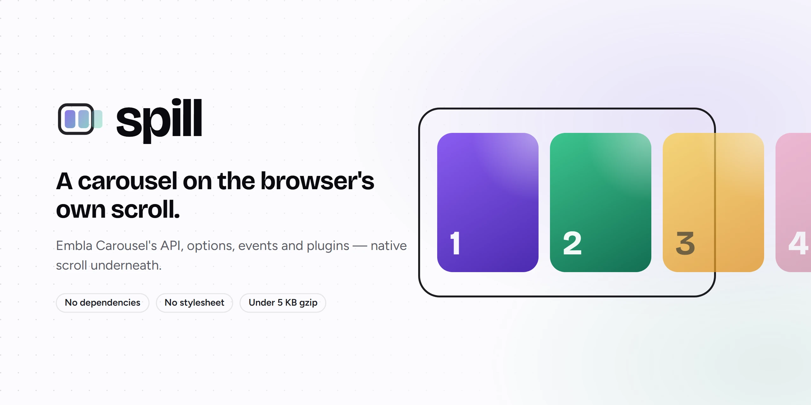

<p align="center">
  <a href="https://spill.bozdev.com">
    <picture>
      <source media="(prefers-color-scheme: dark)" srcset=".github/assets/banner-dark.webp">
      
    </picture>
  </a>
</p>

<p align="center">
  <a href="https://spill.bozdev.com"><b>Docs</b></a> ·
  <a href="https://spill.bozdev.com/examples/">Examples</a> ·
  <a href="https://spill.bozdev.com/docs/api/options/">API</a> ·
  <a href="CHANGELOG.md">Changelog</a>
</p>

<p align="center">
  <a href="https://github.com/bozdev/spill/actions/workflows/test.yml"></a>
  
  
  <a href="LICENSE"></a>
</p>

# Spill

**A carousel on the browser's own scrolling.** Spill has [Embla Carousel](https://www.embla-carousel.com)'s API, options, events and plugin shape — and native scroll underneath. Nothing is moved with transforms: the viewport really scrolls, so a finger's momentum, a trackpad, the keyboard's focus, find-in-page and screen readers all work as they do on any scrolling box. The browser's CSS snap points do the snapping; Spill measures, animates and reports.

- No dependencies. No stylesheet: what it needs to work it writes inline; the look stays yours.
- Embla's API, options and events — code written for Embla mostly runs as is (see [Differences from Embla](#differences-from-embla)).
- Plugins: Autoplay, ClassNames, AutoHeight — with Embla's options, methods and events.
- Attributes: write the markup, the carousel builds itself; its controls can be anywhere on the page.
- Small: the core is 12.6 KB minified, 4.9 KB gzip — Embla's is 17.9 KB / 7.2 KB; each part is its own module.
- Typed: TypeScript declarations ship with it.

```sh
npm install @bozdev/spill
```

```html
<div class="viewport">
  <div class="container">
    <div class="slide">1</div>
    <div class="slide">2</div>
    <div class="slide">3</div>
  </div>
</div>
```

```css
.container { display: flex; gap: 1rem; }
.slide { flex: 0 0 80%; min-width: 0; }
```

```js
import Spill from "@bozdev/spill";

const api = Spill(document.querySelector(".viewport"), { align: "start" });
api.on("select", () => console.log(api.selectedScrollSnap()));
```

**[See it live, with every example →](https://spill.bozdev.com)**

---

## Contents

- [Why native scroll](#why-native-scroll)
- [Install](#install)
- [Markup and CSS](#markup-and-css)
- [Options](#options)
- [Breakpoints and global options](#breakpoints-and-global-options)
- [API](#api)
- [Events](#events)
- [Plugins](#plugins)
- [Attributes](#attributes)
- [Modularity](#modularity)
- [Initialization](#initialization)
- [Accessibility and motion](#accessibility-and-motion)
- [Debugging](#debugging)
- [Differences from Embla](#differences-from-embla)
- [Browser support](#browser-support)
- [Development](#development)
- [Contributing](#contributing)
- [License](#license)

---

## Why native scroll

Embla (and most carousels) move a track with `transform` and rebuild scrolling in JavaScript: the drag, the momentum, the snapping. That was the dependable way when it was written — `scroll-snap` was uneven across browsers, Safari's smooth scrolling came late, there was no `scrollend` event. Today the browser does all of it, and does it better where it matters most: under a finger.

| | Native scroll (Spill) | Transform (Embla) |
|---|---|---|
| A finger's momentum, iOS bounce | **The browser's own** | Imitated |
| Trackpad, shift + wheel | **Works** | Needs a plugin |
| Mouse drag | Spill does it | **Built in** |
| The keyboard's focus brings a slide in | **By itself** | Handled separately |
| Find in page reaches a slide | **Yes** | No |
| Before / without JavaScript | **Scrollable, readable** | A clipped row |
| Scrolling performance | **On the compositor** | Main thread while dragging |
| Snapping | **CSS scroll snap** | JS physics |
| Scroll-driven effects | **CSS `animation-timeline`** | JS |
| Lazy images | **`loading="lazy"`** | Separately |
| Seamless infinite loop | Not here (see below) | **Natural** |
| Duration and easing of programmatic moves | Spill animates it (`duration`) | **Full control** |
| Code | **Smaller** (the browser does the work) | Larger |

---

## Install

**npm** (or pnpm, yarn):

```sh
npm install @bozdev/spill
```

```js
// One of these, as you need — each line stands on its own
import Spill from "@bozdev/spill";                                    // the carousel
import Spill from "@bozdev/spill/core";                               // …the carousel alone, nothing else
import { Spill, Autoplay, ClassNames, AutoHeight, SpillAuto } from "@bozdev/spill"; // every part
import Autoplay from "@bozdev/spill/plugins/autoplay";               // one plugin
import { SpillAuto } from "@bozdev/spill/attributes";                 // carousels by attributes
import "@bozdev/spill/auto";                                          // …built by themselves, the plugins registered
```

**A `<script>` tag** — from a CDN (or `dist/` in this repository):

```html
<!-- window.Spill: the carousel, with Spill.Autoplay, Spill.ClassNames, Spill.AutoHeight, Spill.SpillAuto -->
<script src="https://cdn.jsdelivr.net/npm/@bozdev/spill@0.1.0/dist/spill.global.js"></script>
<script>
  const api = Spill(document.querySelector(".viewport"), { align: "start" }, [Spill.Autoplay()]);
</script>

<!-- …or by attributes alone: every [data-spill-carousel] builds itself, the plugins nameable -->
<script src="https://cdn.jsdelivr.net/npm/@bozdev/spill@0.1.0/dist/spill.auto.js"></script>
```

**The built ES modules** — `@bozdev/spill/dist/spill.esm.js` (every part, one file) and `@bozdev/spill/dist/esm/…` (each module on its own).

**TypeScript** — the declarations come with the package (`types/`): `SpillApi`, `SpillOptions`, `SpillPlugin`, `SpillEventType`, `AutoplayOptions`, `AutoplayType` and the rest, made from the source's JSDoc.

| `dist/` | | Minified | gzip | Brotli |
|---|---|---|---|---|
| `spill.esm.js` | Every part, one ES module | 21.3 KB | 8.0 KB | 7.3 KB |
| `spill.global.js` | For a `<script>` tag: `window.Spill` | 21.7 KB | 8.2 KB | 7.5 KB |
| `spill.auto.js` | For a `<script>` tag, by attributes (started) | 21.9 KB | 8.3 KB | 7.5 KB |
| `esm/spill.js` | The core alone | 12.6 KB | 4.9 KB | 4.5 KB |
| `esm/attributes.js` | `SpillAuto` | 5.2 KB | 2.2 KB | 2.0 KB |
| `esm/plugins/*.js` | Autoplay · ClassNames · AutoHeight | 1.9 · 1.3 · 0.8 KB | 1.0 · 0.7 · 0.5 KB | 0.8 · 0.6 · 0.4 KB |

**Against Embla** (8.6.0, the same measure): its core, `embla-carousel.umd.js`, is 17.9 KB minified / 7.2 KB gzip — Spill's core 12.6 KB / 4.9 KB. Embla's plugins come on top of it as packages of their own; Spill's three and its attributes layer, everything together, are 21.3 KB / 8.0 KB.

---

## Markup and CSS

```html
<div class="viewport">          <!-- the box that scrolls: Spill(viewport, …) -->
  <div class="container">       <!-- its first child (or options.container) -->
    <div class="slide">…</div>  <!-- the container's children (or options.slides) -->
  </div>
</div>
```

**What Spill writes** (inline, removed again by `destroy()`):

| Where | What |
|---|---|
| Viewport | `overflow-x: auto` (`hidden` with `watchDrag: false`) and `overflow-y: hidden`, `overscroll-behavior-x: contain`, `scrollbar-width: none`, `scroll-snap-type: x mandatory` (`none` with `dragFree`, and while it animates or a mouse drags) — the axes swapped for `axis: "y"`; `user-select: none` while a mouse drags |
| Viewport attributes | `data-spill-viewport` (one you wrote stays after `destroy()`), `data-spill-axis` (`"x"` or `"y"`), `data-spill-draggable`, `data-spill-free` (dragFree), `data-spill-dragging` (while a mouse drags) — hooks for your CSS |
| Each snap's first slide | `scroll-snap-align: start`, `scroll-margin-inline-start` (`-block-start` for `axis: "y"`: the snap's alignment, in px), `scroll-snap-stop: always` (unless `skipSnaps`) |
| Container | With `containScroll: false`: room before the first slide and after the last — its `::before` and `::after` as two empty flex items (`data-spill-room`, and the `--spill-room-start`, `--spill-room-end`, `--spill-room-gap` custom properties), so slides sized in % keep their size. Without constructed stylesheets: its padding |

An older WebKit without `scrollbar-width` gets one rule, `[data-spill-viewport]::-webkit-scrollbar { display: none }`, and `containScroll: false` its room's rules — each added once from JavaScript as a constructed stylesheet: no file, no `<style>` element, nothing a Content Security Policy blocks.

**What your CSS does** — the look, as with Embla:

```css
.container { display: flex; gap: 1rem; }            /* a row (a column: flex-direction: column) */
.slide { flex: 0 0 80%; min-width: 0; }              /* a slide's size: 100% one at a time, 33.333% three… */
.viewport[data-spill-draggable] { cursor: grab; }
.viewport[data-spill-dragging] { cursor: grabbing; }
```

Recipes:

- **Slides per view** — `flex-basis`: `calc((100% - 2 * 1rem) / 3)` for three with a 1rem gap; change it in media queries. Spill reads the sizes, never sets them.
- **A grid inside a slide** — any layout: the slide is yours (`display: grid` on it). Spill only scrolls the slides.
- **Peek at the next slide** — `flex-basis: 85%`.
- **Hero** — `flex-basis: 100%`, `align: "start"`, with Autoplay and dots.
- **A column** — `axis: "y"`, a height on the viewport, `flex-direction: column` on the container.
- **Right to left** — `direction: "rtl"` and `dir="rtl"` on the viewport (or an ancestor).
- **Effects as it scrolls** — CSS scroll-driven animations (`animation-timeline: view(inline)`) on the slides, natively.

---

## Options

Embla's options, the same names and defaults (except `loop`).

| Option | Default | |
|---|---|---|
| `align` | `"center"` | Where a snap sits: `"start"`, `"center"`, `"end"`, or `(viewSize, snapSize, index) => px` |
| `axis` | `"x"` | `"x"` or `"y"` |
| `container` | `null` | The slides' parent: a selector (in the viewport) or an element. `null`: the viewport's first child |
| `slides` | `null` | The slides: a selector (in the container), an array or a NodeList. `null`: the container's children |
| `containScroll` | `"trimSnaps"` | `"trimSnaps"`: snaps the edges hold at the same place become one. `"keepSnaps"`: every slide keeps one. `false`: room before the first and after the last, so every snap takes its place — the first and the last slide can be centered too (see [Markup and CSS](#markup-and-css)) |
| `direction` | `"ltr"` | `"ltr"` or `"rtl"` |
| `slidesToScroll` | `1` | Slides per snap: a number, or `"auto"` (as many as fit in view) |
| `inViewThreshold` | `0` | How much of a slide shows to be "in view" (an IntersectionObserver threshold: a number or an array) |
| `breakpoints` | `{}` | `{ "(min-width: 768px)": { …options } }` — merged in while the query matches |
| `dragFree` | `false` | No snapping: it glides and stops where it stops (a mouse's throw included) |
| `dragThreshold` | `10` | px a mouse moves before it drags (a shorter press is a click) |
| `skipSnaps` | `false` | A strong throw can pass several snaps. `false`: one at most (`scroll-snap-stop: always` under a finger) |
| `duration` | `25` | The speed of programmatic moves: 20–60, higher is slower (× 16 ms: 25 ≈ 400 ms) |
| `startIndex` | `0` | The snap it starts on |
| `active` | `true` | `false`: Spill steps aside — nothing written, nothing listened to (with `breakpoints`: a carousel on a phone, a grid on a desktop) |
| `watchDrag` | `true` | A mouse can drag it. `false`: no dragging, and no scrolling by hand (overflow hidden; the API still moves it). A function `(api, event) => boolean`: decides per press |
| `watchResize` | `true` | Measured again when the viewport or a slide changes size along the axis — half a pixel at least, as Embla (the selected snap kept; `reInit`, then `resize`). A function `(api, entries) => boolean` decides |
| `watchSlides` | `true` | Rebuilt when slides are added or removed (`slidesChanged`). A function `(api, mutations) => boolean` decides |
| `watchFocus` | `true` | A focus inside a slide brings its snap (`slideFocus`). A function `(api, event) => boolean` decides |

---

## Breakpoints and global options

```js
Spill(viewport, {
  align: "start",
  breakpoints: {
    "(min-width: 768px)": { slidesToScroll: 2 },
    "(min-width: 1200px)": { active: false },   // a plain layout there: your CSS decides it
  },
});

Spill.globalOptions = { duration: 30 };          // under every carousel's own options
```

A breakpoint that starts or stops matching rebuilds the carousel (`reInit`), the selected snap kept.

---

## API

| Method | Returns | |
|---|---|---|
| `scrollNext(jump?)` | | The next snap (`jump`: no animation) |
| `scrollPrev(jump?)` | | The previous snap |
| `scrollTo(index, jump?)` | | A snap |
| `canScrollNext()` | `boolean` | |
| `canScrollPrev()` | `boolean` | |
| `selectedScrollSnap()` | `number` | |
| `previousScrollSnap()` | `number` | |
| `scrollSnapList()` | `number[]` | Each snap's place, 0 (the start) to 1 (the end) |
| `scrollProgress()` | `number` | Where the scroll is, 0 to 1 |
| `slidesInView()` | `number[]` | |
| `slidesNotInView()` | `number[]` | |
| `slideNodes()` | `HTMLElement[]` | |
| `containerNode()` | `HTMLElement \| null` | `null` while it isn't active |
| `rootNode()` | `HTMLElement` | The viewport |
| `plugins()` | `object` | The plugins by name: `api.plugins().autoplay.stop()` |
| `internalEngine()` | `object` | Not Embla's physics engine: `{ options, slideRegistry, scrollSnaps, limit }` — the options in force, each snap's slides, the snaps' places in px, the scroll range |
| `reInit(options?, plugins?)` | | Rebuilt with options merged in (the selected snap kept) |
| `destroy()` | | Everything it wrote and listened to, gone |
| `on(event, callback)` | `api` | `callback(api, eventName)` |
| `off(event, callback)` | `api` | |
| `emit(event)` | `api` | Fires an event (a plugin's own too) |

---

## Events

| Event | When |
|---|---|
| `init` | Built (after the constructor returns: `api.on("init")` right after it is heard) |
| `reInit` | Rebuilt: `reInit()`, a breakpoint, slides added or removed, a new size (as Embla: then `resize`) — arrows and dots kept up to date here follow all of them |
| `destroy` | Taken down |
| `select` | The selected snap changed (a programmatic move: at its start; a hand's scroll: when the nearest snap changes) |
| `scroll` | It scrolled (once a frame) |
| `settle` | It came to rest (`scrollend`, or 150 ms without a scroll) |
| `resize` | Measured again after a size along the axis changed (the viewport's or a slide's; right after `reInit`) |
| `slidesInView` | The slides in view changed |
| `slidesChanged` | Slides were added or removed |
| `slideFocusStart` / `slideFocus` | A focus went into a slide / its snap was brought |
| `pointerDown` / `pointerUp` | A press on the viewport / its end — any pointer (a finger, a pen, a mouse), a cancelled press too; a mouse's drag between them |

---

## Plugins

Plugins have Embla's shape — `{ name, options, init(api, optionsHandler), destroy() }` plus their own methods — so the ones below can be written for either.

```js
import Spill from "@bozdev/spill";
import Autoplay from "@bozdev/spill/plugins/autoplay";
import ClassNames from "@bozdev/spill/plugins/class-names";

const api = Spill(viewport, { align: "start" }, [Autoplay({ delay: 5000 }), ClassNames()]);
api.plugins().autoplay.stop();
```

### Autoplay

The next snap every `delay` ms; at the last one, back to the first (or a stop). Paused while the page is hidden.

| Option | Default | |
|---|---|---|
| `active` | `true` | |
| `breakpoints` | `{}` | |
| `delay` | `4000` | ms — or `(scrollSnaps, api) => number[]`, one per snap |
| `jump` | `false` | No animation between snaps |
| `playOnInit` | `true` | |
| `stopOnFocusIn` | `true` | A focus inside stops it |
| `stopOnInteraction` | `true` | A press stops it for good (`false`: it starts again after) |
| `stopOnMouseEnter` | `false` | The mouse over it stops it; leaving starts it again |
| `stopOnLastSnap` | `false` | Stops at the last snap instead of going back to the first |
| `rootNode` | `null` | `(viewport) => element`: where the mouse and the focus are watched |

Methods: `play(jump?)`, `stop()`, `reset()`, `isPlaying()`, `timeUntilNext()`. Events: `autoplay:play`, `autoplay:stop`, `autoplay:select`, `autoplay:timerset`, `autoplay:timerstopped`. `Autoplay.globalOptions` like Spill's.

### ClassNames

Classes for the state, to style it: `snapped` (`"is-snapped"`, the selected snap's slides), `inView` (`"is-in-view"`), `draggable` (`"is-draggable"`, on the viewport), `dragging` (`"is-dragging"`, while pressed). Each a string or an array; `active`, `breakpoints`.

### AutoHeight

The container as tall as the selected snap's tallest slide. Give the container `align-items: flex-start` (the slides keep their own heights) and, for a smooth change, `transition: height 0.2s`. `active`, `breakpoints`.

### A plugin of your own

```js
function Logger() {
  let api;
  const log = () => console.log("snap", api.selectedScrollSnap());
  return {
    name: "logger",
    options: {},
    init(carousel, { mergeOptions, optionsAtMedia }) {
      api = carousel;
      api.on("select", log);
    },
    destroy() {
      api.off("select", log);
    },
  };
}
```

---

## Attributes

`SpillAuto` builds carousels from attributes — Flip's way: no script per carousel, and the controls can be anywhere.

```html
<section id="gallery" data-spill-carousel='{"align":"start"}' data-spill-plugins="autoplay"
         data-spill-autoplay='{"delay":5000}' aria-label="Gallery">
  <div data-spill-viewport class="viewport">
    <div class="container"> …slides… </div>
  </div>
  <button data-spill-prev></button>
  <button data-spill-next></button>
  <div data-spill-dots></div>
  <div data-spill-progress></div>
  <button data-spill-play></button>
</section>

<button data-spill-next data-spill-for="gallery">Next, from elsewhere</button>
```

| Attribute | On | |
|---|---|---|
| `data-spill-carousel` | the carousel | Builds it. Its value: the options as JSON (`'{"align":"start"}'`; empty: the defaults) |
| `data-spill-viewport` | a child | The box that scrolls. None marked: the carousel element itself |
| `data-spill-plugins` | the carousel | Plugins by name: `"autoplay class-names auto-height"` (from `SpillAuto.plugins`) |
| `data-spill-<plugin>` | the carousel | A plugin's options as JSON: `data-spill-autoplay='{"delay":3000}'` |
| `data-spill-prev` / `data-spill-next` | a button | The previous / next snap. `aria-disabled="true"` and `data-spill-disabled` at an edge (it keeps its focus) |
| `data-spill-dots` | a box | Filled with a button a snap (`aria-current="true"` on the selected). `="number"`: numbered |
| `data-spill-progress` | any element | Its `--spill-progress`: 0 → 1 as it scrolls (`transform: scaleX(var(--spill-progress))`) |
| `data-spill-to="3"` | a button | The 3rd snap |
| `data-spill-play` | a button | Autoplay on / off (`aria-pressed`) |
| `data-spill-for="<id>"` | a control | Its carousel, by the carousel's id — for a control outside it |
| `data-spill-aria="false"` | the carousel | No roles or labels on the carousel and its slides (the controls keep their labels) |

**What it writes for screen readers** (the author's own attributes stay): the carousel `role="region"`, `aria-roledescription="carousel"`, an `aria-label` when it has none; each slide `role="group"`, `aria-roledescription="slide"`, `aria-label="1 of 5"`; labels for prev, next, play and the dots.

**Words** — the labels, in a site's language (the words you leave out stay English):

```js
SpillAuto.words = {
  carousel: "Carousel", carouselRole: "carousel", slideRole: "slide", slide: "{0} of {1}",
  prev: "Previous slide", next: "Next slide", goTo: "Go to slide {0}", autoplay: "Autoplay",
};
```

**SpillAuto**:

| | |
|---|---|
| `SpillAuto.plugins = { name: factory }` | The plugins `data-spill-plugins` can name (`auto.js` registers the three) |
| `SpillAuto.start({ observe = true })` | Builds every carousel on the page; `observe`: the ones added later too, and takes down the ones removed |
| `SpillAuto.stop()` | Every carousel taken down, nothing watched |
| `SpillAuto.scan(roots?)` | Builds the carousels in these roots (each once) |
| `SpillAuto.forget(roots)` | Takes down the carousels in these roots |
| `SpillAuto.get(element)` | A carousel's API, by its element or anything in it |
| `SpillAuto.all()` | Every carousel built: element → API |

Each carousel built fires `spill:ready` on its element (it bubbles): `event.detail.api`.

---

## Modularity

Every file stands on its own; import what you use (built sizes: [Install](#install)).

| Import | File | |
|---|---|---|
| `@bozdev/spill` | `src/index.js` | Every part, named exports (the carousel is also the default export) |
| `@bozdev/spill/attributes` | `src/attributes.js` | `SpillAuto`: carousels and controls by attributes |
| `@bozdev/spill/plugins/autoplay` | `src/plugins/autoplay.js` | Autoplay |
| `@bozdev/spill/plugins/class-names` | `src/plugins/class-names.js` | ClassNames |
| `@bozdev/spill/plugins/auto-height` | `src/plugins/auto-height.js` | AutoHeight |
| `@bozdev/spill/auto` | `src/auto.js` | Every part + the three plugins registered + `SpillAuto.start()` |
| `@bozdev/spill/core` | `src/spill.js` | The carousel alone (the core) |
| | `src/global.js` | The `<script>` build's entry: `Spill` with the plugins and `SpillAuto` on it |

The package is ES modules with `sideEffects` declared, so a bundler keeps only what you import: the core alone for a hand-built carousel; `attributes.js` for markup-built ones; a plugin only where a carousel names it. A site can load the core when the page has a carousel (`import()` it when `[data-spill-carousel]` is found).

---

## Initialization

**By hand** — `Spill(viewport, options, plugins)`; `api.destroy()` when the carousel leaves the page.

**By attributes** — `auto.js`, or `SpillAuto.start()` after registering the plugins you use.

**A site that swaps its content** (a router, swup, Turbo): start without watching, and tell it what came and what went:

```js
SpillAuto.start({ observe: false });
router.on("contentReplaced", (roots) => SpillAuto.scan(roots));
router.on("beforeReplace", (roots) => SpillAuto.forget(roots));
```

**A carousel built while hidden** (in a closed tab, a dialog): it measures itself again once it shows (its ResizeObserver). Content changed some other way: `api.reInit()`.

---

## Accessibility and motion

- The viewport is a real scrolling box: Tab reaches every link in every slide and the browser brings it into view; `watchFocus` then settles its snap.
- With attributes: roles, `aria-roledescription` and "1 of 5" labels (see [Attributes](#attributes)); prev / next use `aria-disabled` at the edges, so a focused button keeps its focus.
- `prefers-reduced-motion: reduce`: programmatic moves jump instead of animating.
- Autoplay: pauses on focus (`stopOnFocusIn`), while the page is hidden, and on hover with `stopOnMouseEnter`; give users a `data-spill-play` button (WCAG 2.2.2).

---

## Debugging

- **Is it built?** The viewport has `data-spill-viewport`; `SpillAuto.get(element)` returns its API (attributes), or keep the one `Spill()` returned.
- **Where are the snaps?** `api.internalEngine()`: `scrollSnaps` (px), `slideRegistry` (each snap's slides), `limit.max` (the scroll range). In the inspector, each snap's first slide carries `scroll-snap-align: start` and its `scroll-margin-inline-start`.
- **What happens?**

  ```js
  for (const name of ["select", "scroll", "settle", "resize", "slidesInView", "pointerDown", "pointerUp", "reInit"]) {
    api.on(name, (api, event) => console.log(event, api.selectedScrollSnap(), api.scrollProgress().toFixed(2)));
  }
  ```

| It … | Because … |
|---|---|
| doesn't scroll | The slides fit (nothing overflows): give them a `flex-basis`, and the container `display: flex` |
| shows a scrollbar | An older browser without `scrollbar-width` and without constructed stylesheets — add the `::-webkit-scrollbar` rule to your CSS |
| snaps in the wrong place | A `transform` on the container or slides (they're measured where they're drawn); or content changed size without a resize — `api.reInit()` |
| scrolled by your CSS's `overflow: hidden` | Spill's inline `overflow` wins while active; with `active: false` your CSS decides |
| measured 0 | Built while hidden — it measures again when it shows; or call `api.reInit()` |
| ignores a mouse | `watchDrag: false`, or the press started in a field (input, select, textarea, contenteditable) |
| a click after a drag goes nowhere | On purpose: the click a drag ends with is swallowed |
| `init` never heard | Listen right after `Spill()` returns — it fires on the next task |

---

## Differences from Embla

| | Embla | Spill |
|---|---|---|
| Moves with | `transform` | Native scroll |
| `loop` | Yes | No |
| `internalEngine()` | The physics engine | `{ options, slideRegistry, scrollSnaps, limit }` |
| Touch | Its own drag and physics | The browser's scroll, momentum and snapping |
| Mouse | Drag | Drag (and a trackpad, natively) |
| `duration` | A physics value | 20–60 × 16 ms of an eased animation |
| `watchDrag: false` | No drag | No drag, no scrolling by hand (overflow hidden) |
| `select` during a hand's scroll | At the release | When the nearest snap changes |
| A new size | `reInit()` — the plugins built again — then `resize` | Measured again, then `reInit` and `resize` heard as from Embla; the plugins stay as they are (Autoplay's timer runs on) |
| Stylesheet | None | None |
| Plugins | Separate packages | `src/plugins/` — Autoplay, ClassNames, AutoHeight; Fade and WheelGestures aren't needed (a trackpad scrolls natively) or aren't scroll |

---

## Browser support

Current Chrome, Edge, Firefox and Safari (desktop and mobile): CSS scroll snap, `scroll-snap-stop`, IntersectionObserver, ResizeObserver, pointer events. `scrollend` is used where it exists (a timer otherwise); `scrollbar-width` where it exists (a constructed stylesheet otherwise).

---

## Development

```sh
npm install       # esbuild (the build), TypeScript (the types), Playwright (the tests) — Spill itself needs nothing
npm run build     # dist/ (and each file's size: minified, gzip, Brotli), then types/
npm run demo      # http://localhost:4400/demo/
npm test          # Chromium, WebKit, an iPhone
```

`demo/index.html` shows every feature; `tests/spill.spec.mjs` checks the core, the plugins and the attributes on `tests/fixture.html`; `tests/dist.spec.mjs` the built `<script>` files. `dist/` and `types/` are committed (a `<script>` tag straight from the repository, the types with it): run the build before a commit that changes `src/` — CI builds them again and fails when they differ.

**The site** ([spill.bozdev.com](https://spill.bozdev.com)) lives in `site/` (Astro): `cd site && npm install && npm run dev` (port 4331). Its examples run this repository's `src/`. How its pages and examples are written: [`site/WRITING.md`](site/WRITING.md).

---

## Contributing

Issues and pull requests are welcome.

- **A bug:** what you did, what you expected, what happened — and the browser. A minimal page that shows it helps most.
- **A change:** keep Embla's names and behavior where Spill mirrors them; add a test in `tests/spill.spec.mjs` that fails without it; run `npm run build` and `npm test`.
- **The docs:** the site's pages are in `site/src/pages/`, its examples in `site/src/examples/`.

---

## License

[MIT](LICENSE) © [bozdev](https://bozdev.com)
